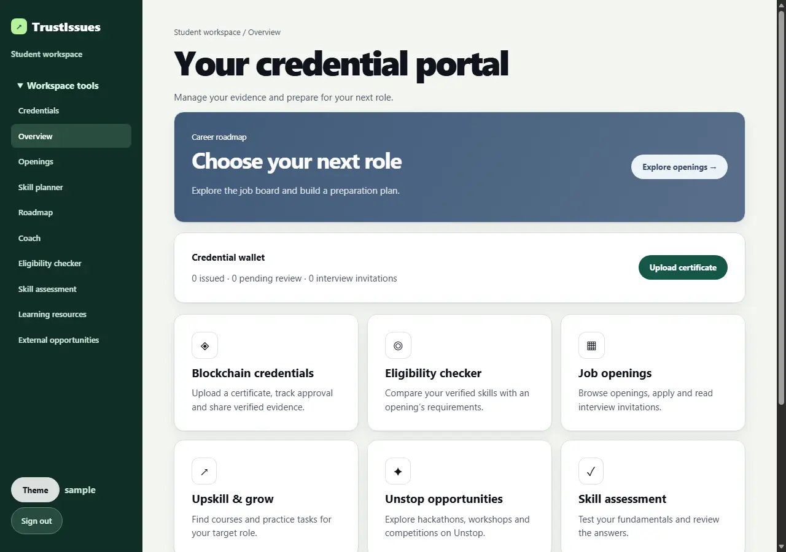
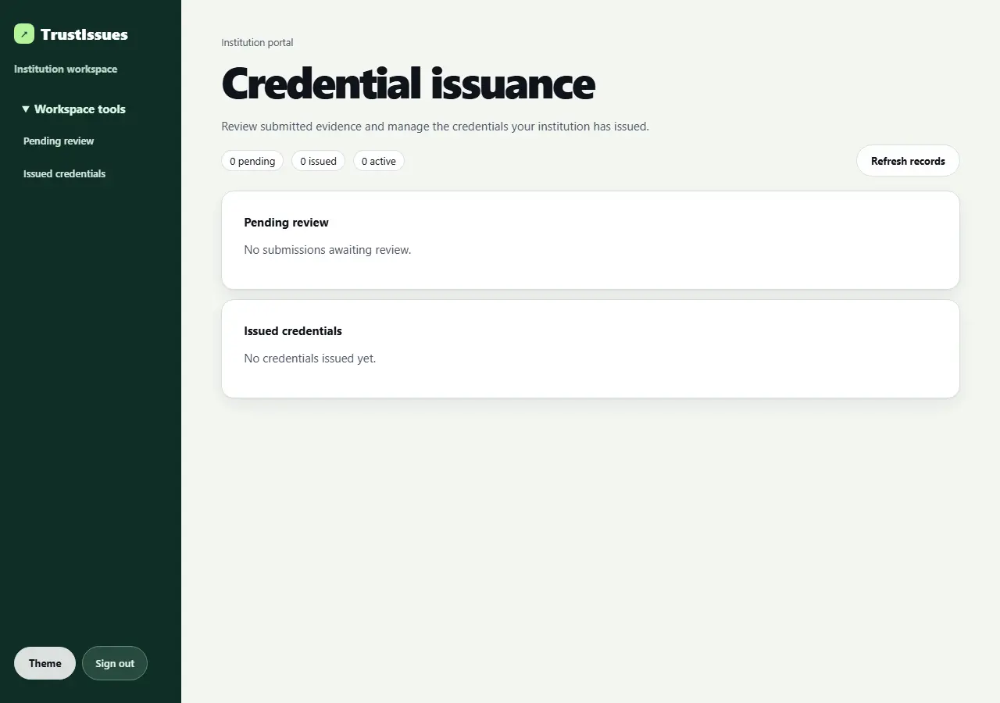
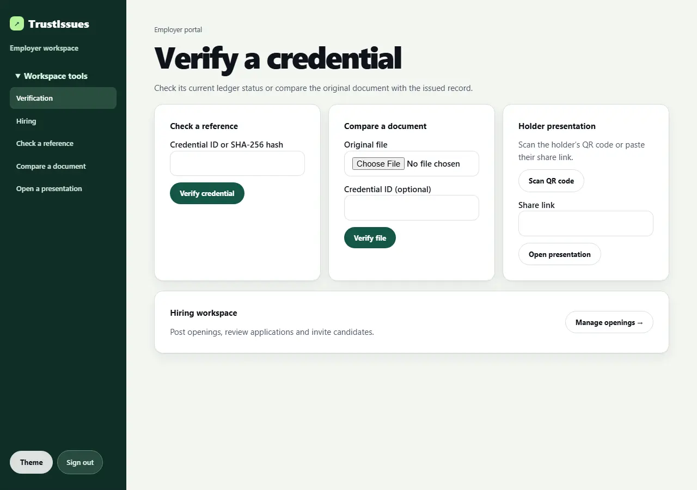

# TrustIssues
### We have trust issues. Bring proof.
**Credentials with receipts. Careers with direction. Built in Go.**

[Get started](#get-started) · [How it works](#how-it-works) · [Releases](https://github.com/atharvtamboli/TrustIssues/releases) · [Roadmap](#whats-next)

A certificate says you can do something. An employer needs evidence. A student needs a way forward.

TrustIssues connects all three. Institutions review and issue credentials. Students carry the proof, share it when needed, and find the skills that could unlock their next role. Employers check the evidence and move the conversation forward.

One Go executable serves the portals, stores encrypted evidence, and records credential events. Run it locally or connect it to a Hyperledger Fabric network.

## Workspace tour

Open **Workspace tools** to reach the actions available to your account. Desktop portals keep the tools in a sidebar. On phones the same menu opens from the bottom edge. Keyboard users can skip directly to the workspace and dismiss the mobile menu with Escape.

### Student

Switch between credentials, openings, eligibility checks, assessments, the skill planner and career guidance from the same menu.

### Institution

Review incoming evidence under **Pending review** and manage issued credentials under **Issued credentials**.

### Employer

Check a reference, compare a document, open a presentation or move into hiring.

Screenshots use isolated demonstration accounts on the local ledger.

## Show your work

| Students | Institutions | Employers |
|---|---|---|
| Upload evidence and track approval | Review submissions for your institution | Post openings and requirements |
| Keep issued credentials in a wallet | Issue credentials with a verification trail | Review applications and verified matches |
| Share expiring presentations with QR codes | Revoke credentials when necessary | Verify shared evidence and file fingerprints |
| Plan what to learn next | Retrieve evidence during review | Send interview invitations |

### Your next skill, with a reason

The **Skill planner** compares your verified credentials with the job board. It ranks individual skills and recommends pairs that would cover the remaining requirements for more openings.

Try a combination. See the roles it affects. Adjust the plan. Download a study brief. Open a role's roadmap for courses and practice tasks.

Selections stay in the current view. Employers see verified evidence. A match describes coverage of listed requirements and carries no hiring guarantee.

### Receipts that survive a second look

Verification checks credential status and document fingerprints. Expiring presentations let students share evidence through a link or QR code. Revoking a credential adds a ledger event and removes its skills from active matches.

## Get started

Install **Go 1.24.1 or newer**. On Windows, provision accounts with the password prompts below, then start the server.

    .\Add-FatBotUser.ps1 -Username student -Role holder
    .\Add-FatBotUser.ps1 -Username institution -Role issuer -Organization "Example University"
    .\Add-FatBotUser.ps1 -Username employer -Role verifier -Organization "Example Company"
    go run .

Open **http://127.0.0.1:5500/login**. Stop the server before creating additional accounts.

On Linux and macOS, provide the password on stdin.

    read -rs -p "Password (12–72 bytes): " TRUSTISSUES_PASSWORD
    printf '\n'
    printf '%s\n' "$TRUSTISSUES_PASSWORD" | go run . user-add student holder -
    unset TRUSTISSUES_PASSWORD
    go run .

### Windows portable release

Extract the complete Windows archive from Releases. Packaged builds run without Go.

    .\Add-TrustIssuesUser.ps1 -Username student -Role holder
    .\Add-TrustIssuesUser.ps1 -Username institution -Role issuer -Organization "Example University"
    .\Add-TrustIssuesUser.ps1 -Username employer -Role verifier -Organization "Example Company"
    .\Start-TrustIssues.ps1

The launcher opens your browser. Refresh if it gets there before the server. Ctrl+C stops the server.

Optional **Install-TrustIssues.ps1** installs under your user and adds a **Start menu shortcut**. The packaged launcher and account helper use **%LOCALAPPDATA%/TrustIssues/data**. Application updates preserve that directory. Scripts follow your system's PowerShell policy. Windows binaries are unsigned.

On Linux and macOS, extract the matching archive and use **./trustissues** in place of **go run .** for provisioning and launch.

## How it works

All accounts in one installation share a ledger. Ownership and role checks control what each portal can access.

| Layer | What lives there |
|---|---|
| Encrypted application state | Accounts, ownership, applications and learning progress |
| Encrypted object files | Original certificates |
| Local ledger | Hash-linked issuance and revocation entries inside application state |
| Optional Fabric network | Credential commitments and status transactions across participating organizations |

The default local backend operates under the host machine owner's control. Distributed ledger operation requires a configured Fabric network. Revocation preserves issuance history. Account deletion and permanent evidence erasure are future work.

The encryption key sits beside the encrypted state. Protect and back up the **whole data directory**, including its key and objects. Read [the Fabric guide](network/CREDENTIALS.md) for network setup, enrollment and acceptance checks.

## Make it yours

The project began as FatBot. Existing configuration and data defaults remain compatible. Set environment variables before starting the app.

| Variable | Purpose |
|---|---|
| FATBOT_DATA | Data directory. Source default is .fatbot |
| FATBOT_ADDR | Default listen address is 127.0.0.1:5500 |
| FATBOT_FABRIC_CONFIG | Fabric gateway configuration |
| FATBOT_TLS_CERT / FATBOT_TLS_KEY | TLS certificate and key paths |
| FATBOT_AI_MODEL / FATBOT_AI_KEY | Optional AI career coach |
| FATBOT_AI_URL | AI endpoint override |

The app reads process environment variables directly. AI coach questions send the selected role and relevant progress to the configured provider. Local roadmap guidance is available without AI.

Root blockchain.json, jobs.json and pending.json files are optional legacy imports. Installation data, private evidence and imports are excluded from Git.

## Build and check

    go test ./...
    go vet ./...
    node --test tests/skill-lab.test.js
    python -m unittest discover -s network -p "test_*.py"
    python scripts/build.py --os windows --arch amd64

Builds and SHA-256 checksums land in **dist/**. The release matrix targets Windows, Linux and macOS on AMD64 and ARM64. Windows is the local validation platform. CI checks Windows and Linux. macOS and ARM64 archives need device validation.

| Location | Purpose |
|---|---|
| Root Go files | Application, storage, authentication and tests |
| web/ | Embedded portals and styles |
| scripts/ | Packaging and Windows integration |
| chaincode/ | Fabric credential contract |
| network/ | Gateway, enrollment and network tools |
| tests/ | Skill recommendation checks |
| .github/workflows/ | Checks and release automation |

## Ship the next version

Update **VERSION** and [release notes](docs/RELEASE_NOTES.md), then push a matching tag such as **v0.1.0**. GitHub Actions builds six portable archives with checksums and creates a draft prerelease. Review the assets and publish the draft when ready.

Regular pushes run checks on Windows and Linux. Package manager distribution and signed installers are planned.

## What's next

- Signed Windows distribution.
- macOS and ARM64 device validation.
- Account lifecycle and evidence-retention controls.
- Multi-organization Fabric pilots with institutions.

[Contributing](CONTRIBUTING.md) · [Security](SECURITY.md) · [Changelog](CHANGELOG.md)

---

**Trust is earned. Proof is checked.**

